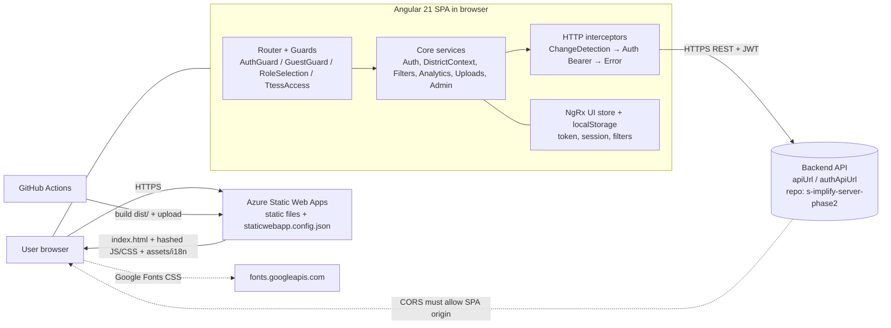

# S-Implify Web — Angular Application Operational Runbook

> **Read this first — the repository differs from the stack assumed in the brief.**
>
> | Brief assumed | What the repository actually contains |
> |---|---|
> | Angular 17–20 | **Angular 21.1.1** (`package.json`, installed `node_modules`) |
> | Azure App Service | **Azure Static Web Apps (SWA)** — no App Service, `web.config` or slot configuration exists |
> | Azure DevOps Pipelines (`azure-pipelines.yml`) | **GitHub Actions** (`.github/workflows/*.yml`) — no Azure DevOps pipeline, variable group or service connection exists |
> | QA / UAT environments | **Local, Dev and Production only** |
>
> Sections 7 and 8 therefore document the **real** GitHub Actions + Static Web Apps delivery path. Azure DevOps / App Service material is limited to short, clearly-labelled *"not in use"* reference notes. Anything that could not be proven from the repository is marked **`[TO BE CONFIRMED]`** and collected in [Appendix A](#appendix-a--to-be-confirmed-register).

---

## Table of Contents

1. [Document Control](#1-document-control)
2. [Application Overview](#2-application-overview)
3. [Application Architecture](#3-application-architecture)
4. [Environment Management](#4-environment-management)
5. [Development Environment Setup](#5-development-environment-setup)
6. [Build and Release Management](#6-build-and-release-management)
7. [CI/CD Pipeline (GitHub Actions — Azure DevOps not present)](#7-cicd-pipeline-github-actions--azure-devops-not-present)
8. [Azure Static Web Apps Deployment (App Service not present)](#8-azure-static-web-apps-deployment-app-service-not-present)
9. [Production Deployment Procedure](#9-production-deployment-procedure)
10. [Rollback Procedure](#10-rollback-procedure)
11. [Monitoring and Logging](#11-monitoring-and-logging)
12. [Troubleshooting Guide](#12-troubleshooting-guide)
13. [Incident Management](#13-incident-management)
14. [Security and Access Management](#14-security-and-access-management)
15. [Maintenance and Operational Activities](#15-maintenance-and-operational-activities)
16. [Operational Checklists](#16-operational-checklists)
17. [Roles and Responsibilities](#17-roles-and-responsibilities)
18. [Known Gaps and Recommendations](#18-known-gaps-and-recommendations)
19. [Reference Information](#19-reference-information)
20. [Appendix A — TO BE CONFIRMED Register](#appendix-a--to-be-confirmed-register)

**Evidence conventions used throughout**

| Tag | Meaning |
|---|---|
| **Verified** | Read directly from a repository file or git history during this analysis |
| **Observed** | Seen in a command/tool output during this analysis (e.g., a local run) |
| **Inferred** | Logical consequence of verified configuration; not exercised end-to-end |
| **`[TO BE CONFIRMED]`** | Not determinable from the repository; needs an owner to confirm |
| **Recommendation** | Not implemented today; proposed improvement |

---

## 1. Document Control

| Field | Value |
|---|---|
| Document title | S-Implify Web — Angular Application Operational Runbook |
| Application name | S-Implify Web (`appName: 'S-Implify'`; npm package/Angular project name `vristo-angular`) |
| Application version | `appVersion: '2.0.0'` in `src/environments/*.ts` (hand-maintained). `package.json` version is `0.0.0` and is not used for releases |
| Document version | 1.0 (Draft) |
| Document owner | `[TO BE CONFIRMED]` — repository is hosted under the GitHub account `engineer-ahmad`; operational owner not stated in the repo |
| Review date | 2026-10-30 (analysis date). Recommended next review: quarterly, and after any pipeline or hosting change |
| Source branch analysed | `dev` @ `8d3af6e`; deployment-relevant files also compared against `origin/prod` @ `8c7c103` |
| Intended audience | Development Team, DevOps Team, QA Team, Production Support Team |
| Related in-repo docs | `README.md`, `ARCHITECTURE.md`, `project-summary-for-gemini.md` (the last two are **partly outdated** — see [Section 18](#18-known-gaps-and-recommendations)) |

### Revision history

| Version | Date | Author | Change |
|---|---|---|---|
| 1.0 | 2026-10-30 | AI-assisted repository analysis | Initial runbook generated from repository evidence; owner review pending |

---

## 2. Application Overview

### 2.1 Purpose and business functionality

*Source: `README.md`, route files, services. Only functionality evidenced in the repository is listed.*

S-Implify is an Angular single-page application (SPA) providing **district, campus, teacher and student performance analytics**. Evidenced capabilities:

| Area | Evidence |
|---|---|
| District/campus growth dashboard with category, campus, teacher and student drill-downs | `features/dashboard/dashboard.routes.ts`, `growth-analytics.service.ts` |
| KPI summary (CCMR rate, graduation rate, T-TESS average) | `dashboard-analytics.service.ts` → `POST /dashboard/overall-percentages` |
| Campus and individual attendance analytics | `features/attendance`, `attendance-analytics.service.ts` |
| CCMR and student standards reporting | `features/academies`, `ccmr-analytics.service.ts`, `student-standards.service.ts` |
| T-TESS teacher assessment | `features/teachers` (guarded by `TtessAccessGuard`), `teacher-assessment.service.ts` |
| Student records with filtering/export | `features/students`, `student-growth-records.service.ts`, `file-saver` |
| Data uploads and upload history (growth sheet, raw scores, campus attendance, CCMR, teacher assessment, standards, individual attendance) | `features/admin/pages/data-uploads`, `simplify-uploads.service.ts` |
| Administrative setups (states, districts, campuses, categories, grades, subjects, cut scores) | `features/admin/pages/user-setups`, `admin-setups.service.ts` |
| User and role management (SuperAdmin, DistrictAdmin, Principal, Teacher) with per-role T-TESS access switch | `src/app/users`, `users.service.ts`, `core/constants/auth-roles.ts` |
| Authentication: sign-in, multi-role selection, role switching, forgot-password and reset-password | `features/auth`, `auth.service.ts` |

### 2.2 Technology stack (Verified)

| Layer | Technology | Version | Source |
|---|---|---|---|
| Framework | Angular (standalone bootstrap, `@angular/*`) | **21.1.1** | `package.json`, installed `node_modules` |
| Language | TypeScript | 5.9.3 | `package.json`, installed |
| Reactive | RxJS / zone.js | 7.8.2 / 0.15.1 | installed |
| State | NgRx Store (`@ngrx/store`) | 21.1.0 | `package.json` |
| Styling | Tailwind CSS 3.4.10, `@tailwindcss/forms`, `@tailwindcss/typography` | — | `package.json`, `tailwind.config.js` |
| Charts / UI | ApexCharts (`ng-apexcharts`), FullCalendar, ng-select, SweetAlert2, Swiper, Quill, Headless UI | various | `package.json` |
| i18n | `@ngx-translate/core` + http-loader; 16 locale JSON files | 15.x / 8.x | `src/assets/i18n/` |
| Build | `@angular-devkit/build-angular:browser-esbuild` | 21.1.1 | `angular.json` |
| Test runner (declared) | Karma + Jasmine | karma ~6.4.2, jasmine-core ~5.2.0 | `package.json`, `angular.json` |
| Package manager | **npm** (lockfile v3) with `legacy-peer-deps=true` | npm 10.x in CI image | `package-lock.json`, `.npmrc` |
| Node.js (CI) | **22** | — | `actions/setup-node` `node-version: "22"`; `README.md` "Node.js 22+"; `Dockerfile.dev` `node:22-alpine` |
| Hosting | **Azure Static Web Apps** | — | `.github/workflows/*`, `src/staticwebapp.config.json` |
| CI/CD | **GitHub Actions** | — | `.github/workflows/` |

**Node.js version policy:** there is **no** `engines` field in `package.json`, no `.nvmrc`/`.node-version`. The only authoritative signals are CI (`22`), README (`22+`) and the dev container (`22`). Angular 21's exact supported Node range should be checked against the [Angular version compatibility table](https://angular.dev/reference/versions) before changing Node major versions `[TO BE CONFIRMED]`.

### 2.3 Angular version

**21.1.1** — newer than the 17–20 range in the brief. Upgrade and compatibility guidance in [Section 15](#15-maintenance-and-operational-activities) is written for Angular 21.

### 2.4 High-level architecture

A browser-only SPA, compiled at build time and served as static files from Azure Static Web Apps. All data comes from a separate backend REST API (`apiUrl`). There is **no server-side rendering and no Node runtime in production**.

### 2.5 Application entry point

| Item | Value |
|---|---|
| HTML shell | `src/index.html` (`<base href="/">`, `<app-root>`, Google Fonts *Nunito* stylesheet) |
| Bootstrap | `src/main.ts` → `bootstrapApplication(AppComponent, appConfig)` (errors → `console.error`) |
| App config | `src/app/app.config.ts` (router, zone change detection, NgRx `StoreModule.forRoot({ index })`, ngx-translate, scrollbar/highlight options) |
| HTTP providers | `src/app/core/core.config.ts` (`provideHttpClient(withInterceptorsFromDi())` + 3 interceptors) |
| Routes | `src/app/app.routes.ts` |
| Polyfills | `src/polyfills.ts` |

### 2.6 Frontend-to-backend communication

- Protocol: HTTPS/JSON REST via Angular `HttpClient`; multipart uploads for data files.
- Base URLs come from `environment.apiUrl` and `environment.authApiUrl` (compiled into the bundle — see [Section 4](#4-environment-management)).
- Authentication: JWT bearer token attached by `AuthInterceptor` to every `HttpClient` request.
- Cross-origin: the SPA origin (Static Web Apps host/custom domain) differs from the API origin, so the **backend must allow CORS** from the SPA origin `[TO BE CONFIRMED]` (backend not in this repo).

**API endpoint families used (Verified from `src/app/core/services/*`)**

| Family | Paths |
|---|---|
| Auth (`authApiUrl`) | `/auth/login`, `/auth/register/super-admin`, `/auth/switch-role`, `/auth/forgot-password`, `/auth/reset-password` |
| Users / roles | `/users`, `/roles` |
| Reference data | `/states`, `/districts`, `/campuses`, `/campus-categories`, `/campus-grades`, `/grades`, `/subjects`, `/academic-years`, `/district-quarters`, `/district-academies`, `/district-subjects` |
| Analytics | `/growth/*`, `/dashboard/*` (e.g., `overall-percentages`), `/campus-attendance`, `/ccmr`, `/student-standards`, `/student-growth-records`, `/student-mobility`, `/teachers`, `/teacher-assessment` |
| Uploads | `/growth-sheet/upload`, `/rawscores-uploads/upload`, `/ccmr/upload`, and per-feature `.../uploads` list/delete endpoints |

---

## 3. Application Architecture

### 3.1 Project structure (Verified)

```text
.
├── .github/workflows/          # GitHub Actions (dev + prod deploy)
├── angular.json                # Build/serve/test configuration
├── package.json / package-lock.json / .npmrc
├── tsconfig.json / tsconfig.app.json / tsconfig.spec.json
├── tailwind.config.js / .prettierrc / .editorconfig
├── Dockerfile.dev / docker-compose.yml   # LOCAL development only
└── src/
    ├── main.ts / index.html / polyfills.ts
    ├── staticwebapp.config.json          # SWA routing + headers
    ├── environments/                      # environment.ts | .dev.ts | .prod.ts
    ├── assets/                            # css, images, i18n (16 locales)
    └── app/
        ├── app.component.* / app.config.ts / app.routes.ts
        ├── core/        # services, guards, interceptors, models, constants, mocks, utils
        ├── features/    # auth, dashboard, attendance, academies, students, teachers, admin
        ├── layouts/     # app-layout, auth-layout, header, sidebar, footer, theme-customizer
        ├── shared/      # shared modules, icon components
        ├── store/       # NgRx root reducer (UI/theme state)
        ├── users/       # user management (lazy NgModule)
        └── apps, components, elements, forms, datatables, pages   # Vristo template sandbox (dev only)
```

Scale: 337 TypeScript files under `src/`.

### 3.2 Components and modules

- **Standalone-first.** `AppComponent` is bootstrapped standalone; feature pages are lazy-loaded with `loadComponent`/`loadChildren` (`*.routes.ts`).
- **Remaining NgModules:** `UsersModule` (`src/app/users`) and the template sandbox modules (`AppsModule`, `ComponentsModule`, `ElementsModule`, `FormModule`, `DatatablesModule`, `PagesModule`).
- **Template sandbox is conditional:** those template routes are registered only when `environment.enableDevSandbox` is `true` (Local and Dev builds). It is `false` in the Production environment file, so the sandbox is excluded from production routing.

### 3.3 Routing architecture (Verified: `src/app/app.routes.ts`)

| Route | Layout | Guard | Notes |
|---|---|---|---|
| `/auth/select-role` | none | `RoleSelectionGuard` | Post-login role picker for multi-role users |
| `/auth/*` (`login`, `register`, `password-reset`, `change-password`, lockscreens, cover pages) | `AuthLayout` | `GuestGuard` (per child) | `boxed-password-reset` → `password-reset`, `reset-password` → `change-password`, `boxed-signin`/`cover-login` → `login` |
| `/` (shell) → `dashboard/**`, `attendance/**`, `academies/**`, `students/**`, `data-uploads`, `user-setups`, users module | `AppLayout` | `AuthGuard` (shell) | `AppLayout` bootstraps district context |
| `/t-tess` | `AppLayout` | `AuthGuard` + `TtessAccessGuard` | Blocked when active role has `ttessAccess = false` |
| `/pages/*` (error pages etc.) | `AuthLayout` | — | **Only registered when `enableDevSandbox` is true** |
| `**` | — | — | Redirects to `dashboard` |

Router uses **path-based (HTML5) URLs**, so the host **must** rewrite unknown paths to `index.html` (see [Section 8](#8-azure-static-web-apps-deployment-app-service-not-present)).

### 3.4 Authentication and authorization (Verified)

- **Sign-in:** `AuthService.login()` → `POST {authApiUrl}/login`. Response (`AuthResponseDto`) is normalised into a session containing `token`, `roles[]`, `activeRole`, and scope IDs (state/district/campus/teacher).
- **Storage (browser `localStorage`):** `simplify_access_token` (JWT), `simplify_user` (full session JSON), `simplify_role_selection_complete`, plus district-context keys and UI preference keys (`theme`, `menu`, `layout`, `rtlClass`, `i18n_locale`, …).
- **Session validity:** `AuthService.isLoggedIn()` decodes the JWT client-side and treats an expired `exp` as logged-out (calls `logout()`).
- **No refresh-token flow:** `refreshTokenKey` exists in environment files but is **not referenced** by application code.
- **Multi-role:** users with more than one role must complete role selection; `switchRole` → `POST {authApiUrl}/switch-role`.
- **Roles** (`core/constants/auth-roles.ts`): SuperAdmin=1, DistrictAdmin=2, Principal=3, Teacher=4.
- **Frontend authorization is limited to:** `AuthGuard` (is logged in), `GuestGuard`, `RoleSelectionGuard`, `TtessAccessGuard`, and role-scoped UI (e.g., sidebar hides T-TESS, locks district selection for scoped roles). The admin routes `data-uploads` and `user-setups` have **no frontend role guard** — enforcement must exist in the backend API `[TO BE CONFIRMED]`.
- **Password recovery:** `/auth/password-reset` → `POST /auth/forgot-password`; `/auth/change-password?token=…` → `POST /auth/reset-password` (token field read-only, populated from the URL query string).
- **Non-production demo login:** `AuthService` contains a hard-coded demo credential path that is active only when `!environment.production && environment.mockBusinessApis`. Both Local and Dev have `mockBusinessApis: false`, so it is inactive in all current deployed configurations. (Credential values intentionally not reproduced here.)

### 3.5 HTTP interceptors (Verified: `core/core.config.ts`)

Registered via `HTTP_INTERCEPTORS` (class-based, `withInterceptorsFromDi()`):

| Order | Interceptor | Behaviour |
|---|---|---|
| 1 (outermost) | `ChangeDetectionInterceptor` | After business API calls complete, schedules `ApplicationRef.tick()` (coalesced) so views refresh |
| 2 | `AuthInterceptor` | Adds `Authorization: Bearer <token>` from `localStorage` to **every** `HttpClient` request regardless of host |
| 3 | `ErrorInterceptor` | `status 0` → "Cannot reach backend…" message; **401** → `localStorage.clear()` + navigate `/auth/login`; **403** → navigate `/pages/error403`; **500** → message; logs `[ErrorInterceptor] <status>: <message>` via `console.error`; rethrows `Error(message)` |

Translation JSON files are loaded with `HttpBackend` (bypasses interceptors, so no token is sent for i18n).

### 3.6 Services and API integration

Singleton `providedIn: 'root'` services in `core/services/`. Key ones:

| Service | Role |
|---|---|
| `AuthService` | Login/logout, session signal + `session$`, role helpers, forgot/reset password |
| `FiltersService` | Cached reference-data calls (`shareReplay`, retry ×2, 800 ms delay; failed calls are evicted from cache) |
| `DistrictContextService` | Global filter/selection context (state, district, campus, teacher, academic year, quarter); bootstrap; persisted in `localStorage`; reset on user change |
| `GrowthAnalyticsService`, `AttendanceAnalyticsService`, `CcmrAnalyticsService`, `DashboardAnalyticsService`, `TeachersService`, `TeacherAssessmentService`, `StudentStandardsService`, `StudentMobilityService`, `StudentGrowthRecordsService` | Feature analytics APIs |
| `AdminSetupsService`, `UsersService`, `RolesService` | Admin/user management |
| `SimplifyUploadsService` | File uploads and history |
| `ApiService`, `SimplifyBackendService` | Generic/legacy HTTP wrappers (add headers themselves) |

**Mock switch:** nearly every service checks `environment.mockBusinessApis`; when `true` it returns in-memory data from `core/mocks/simplify-mock-data.ts` and **makes no HTTP call**. See the critical branch note in [Section 4.3](#43-critical-branch-divergence-on-mockbusinessapis).

### 3.7 State management

- **NgRx Store** (`index` slice, `store/index.reducer.ts`): UI settings only (theme, layout, menu, RTL, locale, animation, navbar, sidebar). Each change also writes to `localStorage`.
- **Business/session state:** Angular signals (`AuthService.session`) and `BehaviorSubject`s in `DistrictContextService`; **not** in NgRx.

### 3.8 Error handling

- Global HTTP error mapping in `ErrorInterceptor` (above).
- Feature components display service errors locally (e.g., sign-in `errorMsg`).
- **No** custom Angular `ErrorHandler`, **no** global unhandled-error reporting.
- Bootstrap failures: `console.error` only (`main.ts`).

### 3.9 Logging

- **Verified:** no logging framework. `console.*` usage in app code is limited to `ErrorInterceptor` (and sandbox sample pages).
- **Verified (negative):** no Application Insights, Sentry, Datadog, New Relic, LogRocket or analytics SDK found in `src/`.

### 3.10 External dependencies

| Dependency | Where | Operational impact |
|---|---|---|
| Backend REST API | `apiUrl` / `authApiUrl` | Hard dependency for all functionality (unless mock flag) |
| Google Fonts (`fonts.googleapis.com`, Nunito) | `src/index.html` | Third-party request on every page load; relevant to any future CSP |
| Azure Static Web Apps | Hosting | Availability, CDN, TLS |
| GitHub Actions + `Azure/static-web-apps-deploy@v1`, `actions/checkout`, `actions/setup-node` | CI/CD | Supply-chain dependency (tag-pinned, not SHA-pinned) |
| npm registry | Build time | Dependency installation |

### 3.11 Architecture diagram



---

## 4. Environment Management

### 4.1 Environments that exist (Verified)

| Environment | Angular configuration | Environment file | Trigger / host | Hosting resource |
|---|---|---|---|---|
| **Local** | `development` (`ng serve` default, no file replacement) | `src/environments/environment.ts` | `npm start` / Docker Compose, `http://localhost:4200` | Developer machine |
| **Dev** | `dev` (`ng build --configuration dev`) | `environment.dev.ts` (replaces `environment.ts`) | Push to `dev` branch → workflow `azure-static-web-apps-mango-tree-03eadcd0f.yml` | Static Web App identified by secret `AZURE_STATIC_WEB_APPS_API_TOKEN_MANGO_TREE_03EADCD0F`; hostname `[TO BE CONFIRMED]` |
| **Production** | `production` (default build configuration) | `environment.prod.ts` (replaces `environment.ts`) | Push to `prod` branch or manual dispatch → `deploy-prod.yml` | Static Web App `simplify-web-prod`, default hostname `kind-pebble-08bbad00f.7.azurestaticapps.net` (from workflow); custom domain `[TO BE CONFIRMED]` |
| QA | — | — | **Not present** | — |
| UAT | — | — | **Not present** | — |

> Do not assume a QA/UAT stage. Use the Dev environment for pre-production verification unless a separate environment is created `[TO BE CONFIRMED]`.

### 4.2 Environment settings (Verified)

| Setting | Local (`environment.ts`) | Dev (`environment.dev.ts`) | Production (`environment.prod.ts` on **`prod` branch**) |
|---|---|---|---|
| `production` | `false` | `false` | `true` |
| `appVersion` | `2.0.0` | `2.0.0` | `2.0.0` |
| `apiUrl` | `http://localhost:8080/api` | `https://simplify-server-dev.niceglacier-fdaf2730.eastus.azurecontainerapps.io/api` | `https://api.s-implify.tech/api` |
| `authApiUrl` | `http://localhost:8080/api/auth` | `…azurecontainerapps.io/api/auth` | `https://api.s-implify.tech/api/auth` |
| `mockBusinessApis` | `false` | `false` | **`false` on `prod`; `true` on `dev`** (see 4.3) |
| `enableDevSandbox` | `true` | `true` | `false` |
| `tokenKey` / `refreshTokenKey` | `simplify_access_token` / `simplify_refresh_token` | same | same |
| `defaultLanguage` | `en` | `en` | `en` |

The dev API is hosted on **Azure Container Apps** (from the hostname). Production backend hosting is not evidenced `[TO BE CONFIRMED]`.

### 4.3 Critical: branch divergence on `mockBusinessApis`

**Verified with `git show`:**

| Ref | `environment.prod.ts` → `mockBusinessApis` |
|---|---|
| `origin/prod` @ `8c7c103` | `false` (live API) |
| `dev` / `origin/dev` @ `8d3af6e` | **`true`** (mock data) |

`prod` is **12 commits ahead of `dev`** and contains fixes `dev` lacks (`git rev-list --left-right --count dev...origin/prod` → `0 12`). Differences in deployment-relevant files:

| File | `dev` branch | `prod` branch |
|---|---|---|
| `src/environments/environment.prod.ts` | `mockBusinessApis: true` | `mockBusinessApis: false` |
| `angular.json` build `assets` | does **not** copy `staticwebapp.config.json` into `dist/` | copies it: `{ glob: "staticwebapp.config.json", input: "src", output: "/" }` |
| `deploy-prod.yml` | no job/step timeouts; `app_location: "/"` + `output_location: "dist"` | `timeout-minutes: 15` job, 2-min test step; `app_location: "dist"`, `output_location: ""` |

**Operational consequences**

1. Any production-configuration build made from the `dev` branch (including `npm run build` locally) produces a bundle that serves **mock data while still using the real login API** — the exact symptom previously reported ("production only shows mock-data").
2. Production correctness currently depends on the `prod` branch carrying the `false` value. A `dev → prod` pull request merges cleanly today, but if anyone edits those lines on `dev`, a conflict or regression is possible.
3. Production deploys must **always** be built from `prod` (the workflow enforces this by trigger).

**Recommendation (Critical):** back-merge `prod` into `dev` so the branches agree, and add a CI guard that fails the production build when `mockBusinessApis` is `true` (see [Section 18](#18-known-gaps-and-recommendations)).

### 4.4 Configuration management

- **Build-time only.** `environment.*.ts` values are compiled into the JavaScript bundle via Angular `fileReplacements`. There is **no runtime configuration** (no `config.json`, no injected `window.__env`, no App Service application settings). Changing an API URL or flag requires a **rebuild and redeploy**.
- Per-environment files are committed to Git. Anything placed there is **public** (it ships to every browser). Do not commit credentials, tokens or secrets to environment files.
- Feature flags: `mockBusinessApis` and `enableDevSandbox` (both build-time).

### 4.5 Secrets management

| Secret | Store | Used by | Notes |
|---|---|---|---|
| `AZURE_STATIC_WEB_APPS_API_TOKEN_PROD` | GitHub Actions secret (scope: repo or `production` environment `[TO BE CONFIRMED]`) | `deploy-prod.yml` | SWA deployment token for production |
| `AZURE_STATIC_WEB_APPS_API_TOKEN_MANGO_TREE_03EADCD0F` | GitHub Actions secret | dev workflow | SWA deployment token for dev |
| `GITHUB_TOKEN` | Auto-issued per run (`permissions: contents: read` in prod workflow) | `repo_token` input | — |

There are no Azure DevOps variable groups or service connections. The frontend itself holds no secrets.

### 4.6 Build-time vs runtime configuration

| Aspect | Build-time (this app) | Runtime (not implemented) |
|---|---|---|
| API base URL | ✔ `environment.*.ts` | ✘ |
| Mock/dev-sandbox flags | ✔ | ✘ |
| Security headers, SPA fallback, cache policy | Shipped as `staticwebapp.config.json` with the artifact | Portal-level SWA settings `[TO BE CONFIRMED]` |
| Secrets | Not in bundle | GitHub secrets (CI only) |

---

## 5. Development Environment Setup

### 5.1 Prerequisites

| Tool | Requirement | Verify |
|---|---|---|
| Node.js | **22.x** (matches CI) | `node -v` |
| npm | Bundled with Node 22 | `npm -v` |
| Git | Any current | `git --version` |
| Backend API | Local API on port `8080` (default local config) — or set `mockBusinessApis: true` locally for UI-only work | `curl -i http://localhost:8080/api/states` (endpoint illustrative) |
| Docker + Compose | Optional (local dev container) | `docker --version` |
| Chrome | Only for Karma tests | — |

### 5.2 Clone and install

```bash
git clone https://github.com/engineer-ahmad/s-implify-web-phase2.git
cd s-implify-web-phase2
git checkout dev
npm ci --legacy-peer-deps
```

`legacy-peer-deps=true` is also set in `.npmrc`; the explicit flag matches CI. Use `npm ci` (lockfile-exact), not `npm install`.

### 5.3 Configure local environment

1. Local uses `src/environments/environment.ts` (`apiUrl` = `http://localhost:8080/api`).
2. Start the backend locally on port 8080, **or** point at the dev API by temporarily using the `dev` configuration (see 5.4).
3. For UI-only work without a backend, set `mockBusinessApis: true` in `environment.ts` locally. **Do not commit this change.**

### 5.4 Start the application

```bash
npm start                        # ng serve --open  (development configuration)
# or
npx ng serve                     # same, without opening a browser
```

> `angular.json` defines `serve` configurations only for `production` and `development`. The `dev` configuration exists for **build** only (there is no `ng serve --configuration dev`). To run locally against the Dev API, temporarily edit `apiUrl`/`authApiUrl` in `environment.ts` (do not commit).

Application URL: <http://localhost:4200>.

**Docker (optional, local only):**

```bash
docker compose up -d --build     # builds Dockerfile.dev (node:22-alpine), runs `ng serve` on :4200
docker compose logs -f web
docker compose down
```

The container bind-mounts the repo (`.:/app`, with an anonymous `/app/node_modules` volume) and polls for changes. It is **not** used for deployment. First compile takes roughly 1–3 minutes (Observed).

### 5.5 Run unit tests

```bash
npm test                                   # ng test (Karma/Jasmine, watch mode)
npm test -- --watch=false --browsers=ChromeHeadless   # command used by CI
```

> **Status — effectively not functional (Verified/Inferred):**
> - **0** `*.spec.ts` files exist under `src/`.
> - No `karma.conf.js` is present (relies on builder defaults).
> - The `test` target in `angular.json` references `src/favicon.ico` and `src/styles.css`, **neither of which exists**.
> - No custom headless Chrome launcher is defined.
>
> The `ng test` command was **not executed** during this analysis `[TO BE CONFIRMED]`. In CI the step is non-blocking (see Section 7).

### 5.6 Run linting

**No linting is configured.** There is no ESLint config, no `lint` target in `angular.json` and no `lint` npm script. Prettier is configured (`.prettierrc`: `semi`, `singleQuote`, `printWidth 160`; `prettier` + `prettier-plugin-tailwindcss` in devDependencies) but has no script.

```bash
npx prettier --check "src/**/*.{ts,html}"   # manual formatting check (no project script exists)
```

### 5.7 Create a production build

```bash
npx ng build --configuration production     # same as `npm run build` (production is defaultConfiguration)
```

Output: `dist/` (flat — `dist/index.html` at the root, **not** `dist/<project>/browser`).

> **Observed local issue:** on the analysis machine, `ng build` failed immediately with *"You installed esbuild for another platform than the one you're currently using"* (`@esbuild/darwin-x64` present, `darwin-arm64` required — an x64/arm64 mix from a Rosetta-installed `node_modules`). Fix: reinstall with a native-architecture Node, i.e. `rm -rf node_modules && npm ci --legacy-peer-deps`. CI (Linux) is unaffected.

---

## 6. Build and Release Management

### 6.1 Build configurations (Verified: `angular.json`)

Builder: `@angular-devkit/build-angular:browser-esbuild`. Project name: `vristo-angular`. `defaultConfiguration`: **`production`**.

| Configuration | Optimization / build optimizer | Source maps | File replacement | Used by |
|---|---|---|---|---|
| `production` | Not overridden (builder default) `[TO BE CONFIRMED]`; `outputHashing: "all"` | Not overridden (builder default) `[TO BE CONFIRMED]` | `environment.ts` → `environment.prod.ts` | `deploy-prod.yml`, `npm run build` |
| `development` | `optimization: false`, `buildOptimizer: false`, `extractLicenses: false`, `namedChunks: true` | `true` | none (uses `environment.ts`, localhost) | `ng serve`, `npm run watch` |
| `dev` | `optimization: false`, `buildOptimizer: false`, `extractLicenses: false`, `namedChunks: true` | `true` | `environment.ts` → `environment.dev.ts` | Dev deploy workflow, `npm run build:dev` |

> **Important (Inferred):** the **Dev** deployment is an **unoptimised build with source maps** (`optimization: false`, `sourceMap: true`). Do not use Dev performance as a proxy for Production.
>
> Production source-map and minification behaviour is not set explicitly in `angular.json`; the verification build could not be run on this machine (esbuild architecture issue and Docker unavailable). A pre-existing local `dist/` of unknown build configuration contained **no `.map` files** and no `localhost` strings (Observed). Confirm on a CI build `[TO BE CONFIRMED]`.

**Budgets (`production`):** initial bundle — warn 5 MB / **error 10 MB**; any component style — warn 2 kB / **error 4 kB**. A component stylesheet over 4 kB fails the production build.

### 6.2 Build output and artifact

| Item | Value |
|---|---|
| Output directory | `dist/` (`outputPath: "dist"`), git-ignored |
| Entry | `dist/index.html`, hashed `chunk-*.js`, `main-*.js`, `styles-*.css`, `assets/` |
| SWA config in artifact | Copied to `dist/staticwebapp.config.json` **only on the `prod` branch** (`angular.json` asset rule) |
| Other assets | `src/assets`, `src/demo-prepare.html` |
| Packaged artifact | **None.** The workflow builds `dist/` on the runner and uploads it straight to Static Web Apps; no `actions/upload-artifact`, no zip, no registry image |
| Artifact retention | **None** beyond GitHub Actions run logs. Rolling back requires a rebuild from Git (see Section 10) |

### 6.3 Production optimisation and hosting-time optimisation

- Content hashing on all output files (`outputHashing: "all"`), enabling the 1-year immutable caching rules in `staticwebapp.config.json`.
- Lazy-loaded routes split the bundle per feature.
- Compression and CDN are provided by Static Web Apps (platform behaviour `[TO BE CONFIRMED]`).

### 6.4 Build validation (what exists today)

| Check | Where | Blocking? |
|---|---|---|
| Angular compile (strict TS, `strictTemplates`) | `ng build` | Yes |
| Bundle/style budgets | `ng build --configuration production` | Yes (errors only) |
| `grep -R "localhost" dist --include="*.js" -l` guard | `deploy-prod.yml` | **Yes** — any match fails the deploy |
| Unit tests | `deploy-prod.yml` | **No** (see Section 7) |
| Lint / `npm audit` / SAST | — | **Not present** |

### 6.5 Release versioning

- No git tags exist (`git tag` is empty). No release notes or changelog.
- `appVersion: '2.0.0'` is hard-coded and not bumped by the pipeline; `package.json` is `0.0.0`.
- The only deployment identifier is the **Git SHA**, printed in the production workflow's step summary (`Git SHA deployed`).
- **Recommendation:** tag every production release (e.g., `v2.0.<n>`) so rollback can target a stable ref (see Section 10).

### 6.6 Branch model (Inferred from merge history)

| Branch | Purpose | Auto-deploy |
|---|---|---|
| `Phase-N/*`, `feature/*` | Feature work | No |
| `dev` | Integration | **Yes → Dev SWA** (push) |
| `prod` | Production | **Yes → Production SWA** (push or manual dispatch) |
| `main` (GitHub default branch) | Stale — last commit "Update README.md", contains no workflows or SWA config | No |

Flow seen in history: feature → PR → `dev` → PR "dev → prod" (e.g., PRs #46, #48) → `prod`. Branch-protection rules are not visible in the repo `[TO BE CONFIRMED]`.

---

## 7. CI/CD Pipeline (GitHub Actions — Azure DevOps not present)

**Azure DevOps status:** no `azure-pipelines.yml`, no pipeline templates, no variable groups, no service connections exist in this repository. If an Azure DevOps project also builds or deploys this app, it is outside the repo `[TO BE CONFIRMED]`. The delivery path below is the only one evidenced.

### 7.1 Pipeline inventory

| Workflow | File | Trigger | Target |
|---|---|---|---|
| **Deploy Frontend to Production** | `.github/workflows/deploy-prod.yml` | `push` to `prod`; `workflow_dispatch` (manual). Deliberately **not** on `pull_request` | Production Static Web App |
| **Azure Static Web Apps CI/CD** (dev) | `.github/workflows/azure-static-web-apps-mango-tree-03eadcd0f.yml` | `push` to `dev` | Dev Static Web App |

### 7.2 Production pipeline (`deploy-prod.yml`, `prod` branch version)

| Item | Detail |
|---|---|
| Agent | `ubuntu-latest` (GitHub-hosted) |
| Concurrency | group `production-frontend`, `cancel-in-progress: false` (deploys queue; none cancelled) |
| Permissions | `contents: read` |
| GitHub environment | `environment: production` (protection rules / required reviewers `[TO BE CONFIRMED]`) |
| Job timeout | **15 minutes** (`timeout-minutes: 15`) — *present on `prod` branch only* |
| Node.js | `actions/setup-node@v4`, Node **22**, npm cache |

**Steps**

| # | Step | Command / action | Blocking? |
|---|---|---|---|
| 1 | Checkout | `actions/checkout@v4` | Yes |
| 2 | Set up Node | `actions/setup-node@v4` (22, cache `npm`) | Yes |
| 3 | Install | `npm ci --legacy-peer-deps` | Yes |
| 4 | Tests | `npm test -- --watch=false --browsers=ChromeHeadless \|\| echo "…skipping (non-blocking)."` with `timeout-minutes: 2` and `continue-on-error: true` | **No — can never fail the build** (the `\|\| echo` makes it always succeed; no specs exist) |
| 5 | Build | `npx ng build --configuration production` | Yes |
| 6 | Localhost guard | `grep -R "localhost" dist --include="*.js" -l` → fail if found | Yes |
| 7 | Deploy | `Azure/static-web-apps-deploy@v1`, `action: upload`, `app_location: "dist"`, `output_location: ""`, `skip_app_build: true`, token `secrets.AZURE_STATIC_WEB_APPS_API_TOKEN_PROD` | Yes |
| 8 | Reachability | `sleep 20; curl -sk` against the SWA default hostname; expects HTTP 200 | **No — only emits a warning** (also uses `-k`, ignoring TLS errors) |
| 9 | Summary | Writes Git SHA and SWA name to `$GITHUB_STEP_SUMMARY` | — |

**Dev workflow differences (`dev` branch):** `actions/checkout@v3` with `submodules: true`; **`npm install --legacy-peer-deps`** (not `npm ci`, so not lockfile-exact); explicit `npx ng build --configuration dev`; **no tests, no localhost guard, no timeouts, no reachability check**; deploys `app_location: 'dist'`. A `close_pull_request_job` exists but is **unreachable** (the workflow only triggers on `push`, yet the job conditions reference `pull_request`).

### 7.3 Quality gates and security controls

| Control | Status |
|---|---|
| Unit tests | Present but non-blocking and non-functional (0 specs) |
| Code quality / lint | **Not present** |
| Dependency vulnerability scan | **Not present** (Observed: `npm ci` in the dev container reported 77 vulnerabilities — 4 low, 24 moderate, 43 high, 6 critical — on 2026-10-23; includes devDependencies) |
| Secrets handling | GitHub secrets for SWA tokens; no secrets in repo |
| Action pinning | Tags (`@v4`, `@v1`, `@v3`), not commit SHAs |
| Approvals before production | `[TO BE CONFIRMED]` (depends on GitHub `production` environment settings and `prod` branch protection) |
| Azure DevOps variable groups / service connections | Not applicable — none exist |

### 7.4 Pipeline flow

```mermaid
flowchart TD
    A[Developer merges PR into prod<br/>or runs workflow_dispatch] --> B[GitHub Actions: deploy-prod.yml<br/>ubuntu-latest, timeout 15 min]
    B --> C{"environment: production<br/>approval rules?<br/>TO BE CONFIRMED"}
    C --> D[Checkout + Node 22 + npm cache]
    D --> E[npm ci --legacy-peer-deps]
    E --> F[npm test headless<br/>NON-BLOCKING, 2 min cap]
    F --> G[ng build --configuration production]
    G --> H{"grep localhost in dist js files"}
    H -- found --> X[Fail build]
    H -- none --> I[Azure/static-web-apps-deploy@v1<br/>upload dist/ with SWA token]
    I --> J[sleep 20 + curl default hostname<br/>WARN only if not 200]
    J --> K[Step summary: Git SHA]

    subgraph DevPath[dev branch push]
      D1[npm install] --> D2[ng build --configuration dev] --> D3[SWA deploy to Dev]
    end
```

### 7.5 Missing stages (recommendations, not existing)

Blocking unit tests; ESLint; `npm audit --audit-level=high`; guard for `mockBusinessApis`; build-artifact upload and retention; post-deploy smoke test that **fails** the job; approval gate evidence; release tagging; deploy from a `workflow_run`/tag. See Section 18.

---

## 8. Azure Static Web Apps Deployment (App Service not present)

### 8.1 Hosting architecture (Verified)

- **Azure Static Web Apps**, deployed from GitHub Actions using a **deployment token** (not a service principal).
- Static content only (`api_location: ""` — no managed Functions API).
- Production resource: **`simplify-web-prod`**; default hostname `https://kind-pebble-08bbad00f.7.azurestaticapps.net` (hard-coded in the workflow; update it if the resource is recreated — `az staticwebapp show -n simplify-web-prod --query defaultHostname`).
- Custom domain: the workflow comment anticipates `https://s-implify.tech`, and the team uses `www.s-implify.tech` for the app. DNS, certificates and domain binding are managed in Azure `[TO BE CONFIRMED]`.
- Resource group, subscription, SKU (Free/Standard), region: `[TO BE CONFIRMED]`.

**Azure App Service: not used.** No `web.config`, no App Service settings, no deployment slots, and no Linux/Windows App Service evidence exist. Do not follow App Service runbooks for this application unless hosting is changed.

### 8.2 SPA hosting requirements

Angular uses path-based routing, so deep links (`/dashboard`, `/auth/login`) must return `index.html` instead of 404. On Static Web Apps this is implemented by `src/staticwebapp.config.json`:

| Rule | Configuration | Effect |
|---|---|---|
| Navigation fallback | `navigationFallback.rewrite: "/index.html"`, excluding `/assets/*` and `*.{css,js,png,jpg,jpeg,svg,ico,webp,woff,woff2,ttf}` | Unknown paths serve the SPA shell |
| 404 override | `responseOverrides.404 → rewrite /index.html, statusCode 200` | Any remaining 404 becomes a **200 HTML response** (see caveat) |
| Cache — assets | `/assets/*` → `public, max-age=31536000, immutable` | 1-year cache |
| Cache — bundles | `/*.js`, `/*.css` → `public, max-age=31536000, immutable` | Safe because filenames are content-hashed |
| Cache — shell | `/index.html` → `no-cache, no-store, must-revalidate` | New releases picked up immediately |
| Headers | `X-Content-Type-Options: nosniff`, `X-Frame-Options: DENY`, `Referrer-Policy: strict-origin-when-cross-origin` | Basic hardening |

**Caveats (Inferred from the config):**

1. **Soft 404s.** Because 404 is rewritten to `index.html` with status 200, a missing JS chunk (e.g., a stale tab after a new deploy) returns HTML with HTTP 200; the browser then reports `Unexpected token '<'` or a chunk-load error rather than a clean 404.
2. **Stale static assets.** `/assets/*` is cached for a year as `immutable`, but asset filenames are **not** content-hashed (e.g., `assets/images/auth/simplify-login-background.png`). Replacing an image or i18n JSON under the same filename will not reach returning browsers until the cache expires. Version the filename when changing assets.
3. **Config must be in the artifact.** Static Web Apps reads `staticwebapp.config.json` from the deployed folder. With `skip_app_build: true` and `app_location: dist`, the file must exist inside `dist/`. On the **`prod`** branch `angular.json` copies it; on the **`dev`** branch it does **not**, so the **Dev site likely has no SPA fallback or custom headers** (Inferred; confirm by requesting a deep link on the Dev site) `[TO BE CONFIRMED]`.

### 8.3 Deployment package structure

```text
dist/
├── index.html
├── main-<hash>.js / chunk-<hash>.js / polyfills-<hash>.js
├── styles-<hash>.css
├── assets/ (css, images, i18n/*.json)
├── demo-prepare.html
├── staticwebapp.config.json      # present on prod branch builds only
└── 3rdpartylicenses.txt          # when extractLicenses is enabled (production)
```

### 8.4 Application settings, slots, health checks

| Topic | Status |
|---|---|
| Application settings / env vars | **None used.** All configuration is compiled in |
| Deployment slots | **Not applicable.** Static Web Apps has no App Service slot swap. Pull-request staging environments are **not** configured (workflow triggers on push only) |
| Health check endpoint | **None.** The only check is the workflow's non-blocking `curl` of `/` |
| HTTPS / custom domain | HTTPS is provided by SWA; certificate and domain details `[TO BE CONFIRMED]` |
| CORS | Not configurable on SWA for the SPA itself; the **backend API** must allow the SPA origin(s): production domain(s), default SWA hostname, Dev hostname `[TO BE CONFIRMED]` |

### 8.5 Deployment validation (see Section 9)

Verify: HTTP 200 on `/`; HTTP 200 + HTML on a deep link (`/auth/login`); response headers match `staticwebapp.config.json`; browser Network tab shows calls to `https://api.s-implify.tech/api/...` (not mock-only and not `localhost`); successful sign-in.

### 8.6 Reference only — App Service hosting (NOT IN USE)

*Included solely so the team knows what would be required if hosting is ever moved. Nothing below exists in this repository and none of it is verified against this app.*

**Windows App Service (IIS)** requires URL Rewrite and a `web.config` deployed next to `index.html`:

```xml
<!-- REFERENCE ONLY — not in repo -->
<configuration>
  <system.webServer>
    <rewrite>
      <rules>
        <rule name="Angular Routes" stopProcessing="true">
          <match url=".*" />
          <conditions logicalGrouping="MatchAll">
            <add input="{REQUEST_FILENAME}" matchType="IsFile" negate="true" />
            <add input="{REQUEST_FILENAME}" matchType="IsDirectory" negate="true" />
          </conditions>
          <action type="Rewrite" url="/index.html" />
        </rule>
      </rules>
    </rewrite>
  </system.webServer>
</configuration>
```

**Linux App Service** has no IIS; it needs a static server with an SPA fallback (for example an nginx `try_files $uri $uri/ /index.html;` configuration or the built-in PHP/Node static options) and cache headers equivalent to Section 8.2.

---

## 9. Production Deployment Procedure

**Scope:** release `dev` content to production via the `prod` branch. Responsible team in brackets.

### Step 1 — Pre-deployment verification [Dev Lead + QA]

1. Confirm release scope, related backend release, and API compatibility (Section 10.4).
2. Confirm Dev environment sign-off (there is no QA/UAT environment).
3. Check for open P1/P2 incidents; avoid deploying during an incident.
4. Confirm `prod` branch configuration:

   ```bash
   git fetch origin
   git show origin/prod:src/environments/environment.prod.ts | grep -E "mockBusinessApis|apiUrl|production|enableDevSandbox"
   ```

   **Expected:** `production: true`, `mockBusinessApis: false`, `apiUrl: 'https://api.s-implify.tech/api'`, `enableDevSandbox: false`. **If `mockBusinessApis` is `true`, stop** (Section 4.3).

### Step 2 — Source branch validation [Dev Lead]

```bash
git rev-list --left-right --count origin/prod...origin/dev      # left = only in prod, right = only in dev
git log --oneline origin/prod..origin/dev                        # commits to be released
git diff --stat origin/prod origin/dev -- src/environments angular.json .github   # review config drift
```

Review the diff for `environment.*.ts`, `angular.json`, `.github/`, `staticwebapp.config.json`. Ensure the PR will not revert `prod`-only fixes (Section 4.3).

### Step 3 — Build validation [Dev]

On a clean Node 22 checkout of the release commit (or rely on CI):

```bash
npm ci --legacy-peer-deps
npx ng build --configuration production
```

**Expected:** build completes with exit code 0 and no budget **errors**.

```bash
grep -R "localhost" dist --include="*.js" -l && echo "FAIL: localhost found" || echo "OK: no localhost"
ls dist/index.html dist/staticwebapp.config.json
```

**Expected:** `OK: no localhost`; both files exist. Run this on the **`prod`** (or release-candidate merged-into-`prod`) code: a build from the current `dev` branch will not contain `dist/staticwebapp.config.json` and will carry `mockBusinessApis: true` (Section 4.3).

### Step 4 — Unit test validation [QA]

There are no automated unit tests today. Replace with a **manual regression** on the Dev site covering the smoke-test matrix in Step 8 `[TO BE CONFIRMED: QA sign-off format]`.

### Step 5 — Artifact verification [DevOps]

No artifact is stored. Verification occurs on the run: open the GitHub Actions run and confirm Install, Build, and **Guard against dev/localhost URLs** steps are green.

### Step 6 — Deployment approval [Application Owner / Release Manager]

1. Open and approve the `dev → prod` pull request (reviewers per branch protection `[TO BE CONFIRMED]`).
2. If the GitHub `production` environment has required reviewers, approve the pending deployment `[TO BE CONFIRMED]`.
3. Record the approver and the release commit SHA.

### Step 7 — Deploy to Azure Static Web Apps [DevOps]

Option A (standard): merge the PR into `prod` — the push triggers the workflow.

Option B (manual, same branch):

```bash
gh workflow run deploy-prod.yml --ref prod
gh run list --workflow=deploy-prod.yml --limit 3
gh run watch <RUN_ID>
```

Deploys are serialised by `concurrency: production-frontend`. Job timeout is 15 minutes. **Expected:** all steps green; step summary shows "Frontend production deployment complete" and the deployed Git SHA. A `::warning::` from "Verify site is reachable" is **not** a failure — verify manually (Step 9).

### Step 8 — Post-deployment smoke testing [QA]

Allow ~1 minute for CDN propagation, then test in a **private/incognito window** (avoids cached `index.html`/session state).

| # | Check | Expected |
|---|---|---|
| 1 | Open production URL | App loads; no blank screen |
| 2 | Deep link `/auth/login` directly | Login page renders (no 404) |
| 3 | Sign in as each role: SuperAdmin, DistrictAdmin, Principal, Teacher | Success; multi-role user is routed to role selection |
| 4 | DevTools → Network on the dashboard | Requests go to `https://api.s-implify.tech/api/...` with 200; **no** `localhost`; data is not mock |
| 5 | Dashboard KPIs (CCMR, Graduation, T-TESS) | Load from `/dashboard/overall-percentages` |
| 6 | T-TESS menu | Hidden for a role with `ttessAccess=false`; visible otherwise |
| 7 | Data uploads page loads and history lists | 200 from API |
| 8 | Forgot password: submit email | Success message; email received |
| 9 | Reset link `/auth/change-password?token=…` | Token field disabled and pre-filled; password reset succeeds |
| 10 | Logout | Redirects to `/auth/login`; no failing API calls |
| 11 | DevTools → Console | No uncaught errors |

### Step 9 — Application availability verification [DevOps / Production Support]

```bash
SWA=https://kind-pebble-08bbad00f.7.azurestaticapps.net
curl -sI "$SWA/"                       | head -n 15    # expect HTTP/2 200
curl -sI "$SWA/auth/login"             | head -n 15    # expect HTTP/2 200 (SPA fallback)
curl -sI "$SWA/index.html" | grep -i cache-control      # expect no-cache, no-store, must-revalidate
curl -sI "$SWA/" | grep -iE "x-frame-options|x-content-type-options|referrer-policy"
curl -sI https://api.s-implify.tech/api/auth/login      # API reachable (method/status illustrative)
```

Repeat against the custom domain once confirmed `[TO BE CONFIRMED]`.

### Step 10 — Release sign-off [Application Owner]

1. QA and DevOps confirm Steps 8–9 pass.
2. Tag the release (recommended): `git tag v2.0.<n> <sha> && git push origin v2.0.<n>`.
3. Record deployed SHA, time, approvers and results; notify stakeholders.
4. Monitor for 30–60 minutes (Section 11).

---

## 10. Rollback Procedure

### 10.1 Facts that shape rollback (Verified)

- **No deployment slots** and no swap capability (Static Web Apps).
- **No stored build artifacts** — the workflow does not upload `dist/`; a rollback means **rebuilding and redeploying a previous Git ref**.
- **No git tags/releases** exist today; stable versions must be identified from history.
- Whether the Azure portal lets you promote a prior production deployment is `[TO BE CONFIRMED]` — **do not rely on it**.

### 10.2 Identify the last stable release

```bash
git log origin/prod --first-parent --oneline -15          # production release merges
gh run list --workflow=deploy-prod.yml --status success --limit 10 \
  --json databaseId,headSha,createdAt,displayTitle
```

Pick the most recent **successful** run whose SHA predates the problem. The run step summary records `Git SHA deployed`.

> **Constraint:** the last-good SHA must be **at or after commit `8c58084`** ("Fix SWA deploy: app_location must point at dist/ directly"). Workflow versions before that fix used an `app_location` that the deploy action rejected, so a rollback to an older ref would fail to deploy.

### 10.3 Rollback options

**Option A — Revert on `prod` (preferred; keeps history)**

1. Identify the bad change (a PR merge commit on `prod`).
2. ```bash
   git checkout prod && git pull origin prod
   git revert -m 1 <MERGE_COMMIT_SHA>     # -m 1 for PR merge commits
   git push origin prod                    # or open a PR if branch protection requires it
   ```
3. The push triggers `deploy-prod.yml`; watch the run.
4. Back-merge the revert into `dev` so the branches stay aligned.

**Option B — Redeploy a known-good ref by manual dispatch**

1. Create a rollback tag on the last-good SHA (also gives you a stable reference):
   ```bash
   git tag rollback-$(date +%Y%m%d)-<short-sha> <GOOD_SHA>
   git push origin rollback-$(date +%Y%m%d)-<short-sha>
   ```
2. Dispatch the workflow from that tag:
   ```bash
   gh workflow run deploy-prod.yml --ref rollback-<date>-<short-sha>
   gh run watch <RUN_ID>
   ```
3. This deploys the **code and workflow definition of that ref** (it must contain `workflow_dispatch`, true for all revisions since the first prod workflow `850fd73`, and satisfy the `8c58084` constraint above).
4. After recovery, reconcile `prod` (e.g., `git revert` the bad change) so the next push to `prod` does not re-deploy the faulty code.

**Option C — Azure portal redeploy** — `[TO BE CONFIRMED]`; not a documented path for this app.

**Slot swap: not applicable.** Never assume slots exist.

### 10.4 Configuration and compatibility considerations

| Topic | Guidance |
|---|---|
| Frontend configuration | `environment.*.ts` and `staticwebapp.config.json` ship **inside** the build, so rolling back the code rolls back the configuration |
| Secrets | SWA token is independent of code; rotate separately if compromised |
| Backend/API compatibility | The SPA depends on backend contracts introduced over time, for example the `ttessAccess` field on role assignments, `POST /dashboard/overall-percentages`, `summativeScore`/`averageScore` assessment fields, and `forgot-password`/`reset-password`. Rolling the frontend back **behind** a backend that removed or changed those contracts (or the backend back **behind** a newer frontend) can break screens. Confirm the compatibility matrix with the backend team before rollback `[TO BE CONFIRMED]` |
| Database | No database in this application; schema changes belong to the backend |
| Browser cache | Returning users may hold old `index.html` or chunks; `index.html` is `no-cache`, bundles are hash-named, so recovery is automatic after reload. Stale `/assets/*` (immutable, un-hashed) may persist — instruct a hard refresh if needed |

### 10.5 Post-rollback validation

Repeat Section 9 Steps 8–9 on the rolled-back version, confirm the deployed Git SHA in the run summary equals the intended SHA, check error rates (Section 11), and record the result.

### 10.6 Incident communication

Notify the incident channel and stakeholders at: decision to roll back, rollback started, rollback complete, and service verified. Include the affected SHA, rollback target SHA, user impact and the follow-up post-incident review (Section 13).

---

## 11. Monitoring and Logging

### 11.1 What exists today (Verified)

| Capability | Status |
|---|---|
| Application Insights / RUM / error tracking | **Not configured** (no SDK in code) |
| Application logging framework | **None**; `console.error('[ErrorInterceptor] <status>: <message>')` only |
| Global Angular `ErrorHandler` | **None** |
| Health endpoint / synthetic availability test | **None** |
| Alerting | **None in repo** `[TO BE CONFIRMED]` for Azure-side alerts |
| Deployment logs | GitHub Actions run logs and step summary |

### 11.2 Available data sources and how to use them

| Source | Use | How |
|---|---|---|
| **GitHub Actions** | Deploy status, SHA, durations | `gh run list --workflow=deploy-prod.yml`; run logs |
| **Azure Static Web Apps (portal)** | Resource status, domains, environments, metrics | Azure Portal → `simplify-web-prod` `[TO BE CONFIRMED]` |
| **Azure Activity Log** | Who changed/deleted the SWA resource, token resets | Portal → Activity log |
| **Browser DevTools — Console** | JS runtime errors; `[ErrorInterceptor]` lines | F12 → Console |
| **Browser DevTools — Network** | HTTP codes (401/403/500/0), wrong API host, CORS preflights, soft-404 HTML for JS chunks | F12 → Network; filter `Fetch/XHR` |
| **HTTP checks** | Availability, headers | `curl -sI <url>` |
| **Backend logs / APM** | API 5xx and latency | Backend team `[TO BE CONFIRMED]` |

### 11.3 Diagnostic procedures

1. **Is the site up?** `curl -sI https://<host>/` → 200. Non-200 → check Azure status and the last deploy.
2. **Is the API up?** Open DevTools → Network; failing calls with status `0` indicate unreachable/CORS (the interceptor shows *"Cannot reach backend…"*). Test the API URL directly with `curl`.
3. **Which build is live?** Compare the live bundle filenames/`index.html` with the latest successful run's SHA; check the run summary.
4. **Auth issues?** In DevTools → Application → Local Storage confirm `simplify_access_token`; decode its `exp` (any JWT decoder); 401 triggers `localStorage.clear()`.
5. **Wrong data source?** Network tab shows **no** API calls on data screens → mock flag is on in that build (Section 4.3).

### 11.4 Monitoring gaps and recommendations

| Gap | Recommendation | Priority |
|---|---|---|
| No client-side error/performance telemetry | Add Application Insights JS SDK (or equivalent) with an Angular `ErrorHandler` | High |
| No availability monitoring | Azure Monitor availability test / external uptime check on `/` and `/auth/login`, plus an API health URL | High |
| No alerts | Alert on availability failure, deploy failure, and API 5xx rate | High |
| Post-deploy check is warn-only | Make the smoke step fail the job | Medium |
| No release correlation | Tag releases; emit `appVersion` + SHA into the build | Medium |
| No log retention policy | Define GitHub run-log and Azure Activity Log retention `[TO BE CONFIRMED]` | Low |

---

## 12. Troubleshooting Guide

**Legend — Basis:** **C** = confirmed from repository evidence; **O** = observed locally; **G** = general guidance (not specific to a confirmed occurrence).

| Issue | Symptoms | Possible Cause | Investigation | Resolution | Escalation |
|---|---|---|---|---|---|
| **Application fails to load** (G) | Browser error page, timeout, or SWA error | SWA outage/DNS/cert issue; deployment never completed; wrong URL | `curl -sI <url>`; check Azure status/resource; last Actions run | Fix DNS/cert; redeploy last good ref (Section 10) | DevOps → Azure support (P1 if production down) |
| **Blank screen after deployment** (C/G) | White page; console shows `Unexpected token '<'` or chunk-load failure | Wrong deploy folder (`app_location`) so no `index.html`; stale tab requesting removed hashed chunks — missing chunks return **HTML with HTTP 200** because of the SWA 404 override; runtime exception during bootstrap | Console + Network (look for JS requests returning `text/html`); inspect run log "Deploy" step; hard refresh | Hard refresh / clear site data; verify `app_location: "dist"` contains `index.html`; redeploy | Dev Lead if reproducible after hard refresh |
| **HTTP 404 on Angular routes** (C/Inferred) | Direct URL or refresh on `/dashboard` gives 404 | `staticwebapp.config.json` missing from `dist/` — **Dev branch does not copy it** (`angular.json`); SPA fallback not applied | `curl -sI <host>/auth/login`; check `dist/staticwebapp.config.json` in the build | Add the asset copy rule to the `dev` branch (back-merge `prod`) and redeploy | DevOps |
| **HTTP 401 errors** (C) | Sudden redirect to `/auth/login`; repeated logouts | Token expired (client treats `exp` as logout); backend rejected token; clock skew | Network → 401 response; decode token `exp`; check backend logs | Sign in again; confirm backend token lifetime; there is **no refresh-token flow** | Backend team if tokens expire prematurely |
| **HTTP 403 errors** (C/Inferred) | User lands on the dashboard unexpectedly; "no permission" behaviour | `ErrorInterceptor` navigates to `/pages/error403`, but `/pages/*` is **only registered when `enableDevSandbox` is true** — in Production the `**` fallback sends the user to `dashboard`; or role lacks permission on backend | Network → 403 on the failing API call; confirm role/scope in `simplify_user` | Grant correct role/scope; fix route registration (Section 18) | Backend/Application Owner |
| **HTTP 500 API errors** (G) | Screens show "Internal server error. Please try again later."; Network shows 5xx | Backend defect or dependency failure | Network → response body; `curl` the endpoint; backend logs | Roll back backend or fix; frontend rollback only if the release changed the request | Backend team (P2/P1 by impact) |
| **CORS failures** (G) | Console: *blocked by CORS policy*; Network `status 0`; interceptor: "Cannot reach backend. Please check network/CORS" | Backend CORS allow-list missing the SPA origin (production domain, default SWA host, Dev host); preflight not allowed for `Authorization` header | Network → failed `OPTIONS` preflight; compare `Origin` with backend allow-list | Add the origin to backend CORS config; no frontend change required | Backend/DevOps |
| **Incorrect API endpoint** (C) | Calls go to `localhost`, to the dev API from production, or nowhere | Wrong build configuration used (`--configuration` mismatch); local `ng build` without `production`; env file edited | Network tab → request host; compare with Section 4.2; CI localhost guard result | Rebuild with the correct configuration; deploy from `prod` | Dev Lead |
| **Production shows mock data / no API calls** (C) | Data looks static; Network shows **no** business API calls; login still works | `mockBusinessApis: true` in the built `environment.prod.ts` — currently the value on the **`dev`** branch | `git show <ref>:src/environments/environment.prod.ts`; Network tab | Set `false`, rebuild and redeploy from `prod`; add CI guard (Section 18) | Dev Lead (P2 — functional incorrectness) |
| **Missing environment configuration** (C) | `undefined` URLs, calls to relative paths | Required key missing from an environment file | Compare `environment.*.ts` keys across files; compile errors | Add the key to **all** environment files | Dev |
| **JavaScript runtime errors** (G) | Broken widgets; console exceptions | Application bug, API contract change, stale cache | Console stack trace; reproduce on Dev; check last release diff | Fix forward or roll back (Section 10) | Dev Lead |
| **npm dependency installation failures** (O/C) | `npm ci` errors: `ERESOLVE`, peer-dependency conflicts; `esbuild` platform mismatch | Peer conflicts (project requires `--legacy-peer-deps`); lockfile out of sync; x64/arm64 mixed `node_modules` (**Observed**: `@esbuild/darwin-x64` present, arm64 required) | Full npm error; `node -v` / `uname -m`; check `.npmrc` | Use `npm ci --legacy-peer-deps`; `rm -rf node_modules && npm ci --legacy-peer-deps` with native Node 22; commit lockfile changes | Dev Lead |
| **Angular build failures** (C/G) | `ng build` exits non-zero | TypeScript strict/`strictTemplates` errors; **component style > 4 kB** (budget error); initial bundle > 10 MB; missing import | Read the first error in the build log | Fix the error; split large styles; avoid raising budgets without review | Dev |
| **Azure deployment failures** (C/G) | Deploy step red; timeout at 15 min | Missing/rotated `AZURE_STATIC_WEB_APPS_API_TOKEN_PROD`; wrong `app_location` (deploy action looks for `index.html` at `app_location`); SWA resource recreated (hostname changed); Azure incident | Open the failing step log; confirm secret exists; confirm `dist/index.html` | Reset token in Azure and update the GitHub secret; correct `app_location`; re-run workflow | DevOps → Azure support |
| **App Service startup failures** (C) | — | **Not applicable.** App Service is not used | — | — | — |
| **Performance degradation** (G/C) | Slow first load or slow dashboards | Large initial bundle; many parallel API calls; API latency; **Dev** build is unoptimised (don't compare); reference calls retry ×2 with 800 ms delay when failing | Network waterfall; Lighthouse; API timing; bundle report | Optimise queries/payloads; lazy-load; investigate API | Dev Lead / Backend (P3→P2) |
| **Authentication failures** (C/G) | Cannot sign in; login loops; role picker loop; reset-password fails | Wrong credentials; API unreachable; user has multiple roles but selection not completed (`simplify_role_selection_complete`); reset link missing/expired `token` (field is read-only, filled from `?token=`) | Network → `/auth/login` response; localStorage keys; reset URL contains `token` | Complete role selection; clear site data; reissue reset email | Backend if API errors persist |
| **Stale images/i18n after release** (Inferred) | Old logo/background/translations persist | `/assets/*` cached 1 year `immutable`, un-hashed filenames | Network → `Cache-Control` and `(disk cache)` | Rename the asset file; hard refresh | Dev |
| **Local Docker app unreachable** (O) | `localhost:4200` not responding | Docker Desktop not running; first compile (1–3 min) still in progress | `docker compose logs -f web` | Start Docker; wait for "Application bundle generation complete" | Dev |

---

## 13. Incident Management

> Severity definitions below are a **recommended policy**; no formal incident policy exists in the repository `[TO BE CONFIRMED]`.

### 13.1 Severity levels

| Level | Definition | Examples | Target response |
|---|---|---|---|
| **P1 — Critical** | Production unavailable or data/security compromised for all/most users | Site down; nobody can sign in; security breach | Immediate (≤15 min), 24×7 |
| **P2 — High** | Major function broken or wrong data shown, with no workaround | Production serving mock data; dashboards fail for a district; uploads failing | ≤1 hour |
| **P3 — Medium** | Partial/minor degradation with a workaround | One page slow; cosmetic regression | Same/next business day |
| **P4 — Low** | Minor issue, no functional impact | Typos, minor UI defects | Backlog |

### 13.2 Standard lifecycle (applies to every incident type)

1. **Initial assessment** — confirm the report; capture time, URL, user role, browser, screenshots, Network/Console evidence.
2. **Impact identification** — number of users/districts/roles; severity (P1–P4).
3. **Investigation** — start with "what changed?" (last deploy SHA/time, backend release), then Section 12.
4. **Mitigation** — fastest safe action (rollback, config fix, workaround).
5. **Recovery** — verify with Section 9 Steps 8–9.
6. **Communication** — initial notice, periodic updates (P1: every 30 min), resolution notice.
7. **Post-incident review** — within 5 business days for P1/P2: timeline, root cause, actions, owners.

### 13.3 Incident-type procedures

**A. Production application outage (P1)**

1. Check `curl -sI` on the SWA hostname and custom domain; check Azure status/resource health.
2. If correlated with a deploy: roll back (Section 10, Option A/B).
3. If not: engage Azure support; consider a status message to users.
4. Verify recovery; start post-incident review.

**B. Authentication outage (P1/P2)**

1. Confirm SPA loads but `/auth/login` calls fail (Network).
2. Distinguish: `status 0` (API/CORS/DNS) vs 401/5xx (backend auth service).
3. Engage the backend team; check backend deploy history and CORS.
4. Frontend rollback only if the latest frontend release changed auth flows.
5. Communicate: users already signed in may keep working until token expiry.

**C. Backend API outage (P1/P2)**

1. Confirm via direct `curl` to `https://api.s-implify.tech/api/...`.
2. Capture affected endpoints; engage the backend/infrastructure team.
3. The SPA shows "Internal server error" / "Cannot reach backend"; there is no offline mode in production. **Do not enable mock mode in production** as a workaround (it would present false data).
4. Communicate impact; recover when API health is restored.

**D. Deployment failure (P3→P2)**

1. Open the failed run; identify the failing step (install, build, localhost guard, deploy).
2. Production keeps serving the previous version unless a partial deploy occurred; verify with Section 9 Step 9.
3. Fix forward (token, config, build error) and re-run, or abandon and revert the offending commit.
4. If production is degraded after a "successful" deploy, roll back.

**E. Security incident (P1)**

1. Contain: rotate the SWA deployment token (Azure → Manage deployment token) and update the GitHub secret; revoke compromised GitHub access.
2. Assess: a leaked JWT/user session (stored in `localStorage`) → coordinate token invalidation with the backend; check GitHub Actions history and Azure Activity Log for unauthorised changes.
3. Eradicate: remove malicious code; redeploy from a verified commit.
4. Notify security/legal per policy `[TO BE CONFIRMED]`; preserve evidence; run the post-incident review.

**F. Performance degradation (P3/P2)**

1. Determine scope (all users vs one page vs one district).
2. Separate frontend (bundle size, rendering) from API latency using the Network tab.
3. Check recent deploys (frontend or backend).
4. Mitigate (rollback / backend scaling), then optimise.

---

## 14. Security and Access Management

### 14.1 Authentication and authorization

See Section 3.4. Key points: JWT in `localStorage`; client-side expiry check only; **no refresh tokens**; frontend authorization is UX-level (guards, menu hiding) and **must be backed by backend enforcement** `[TO BE CONFIRMED]`; admin routes have no frontend role guard.

### 14.2 Azure RBAC and access

- Azure subscription, resource group and RBAC assignments for `simplify-web-prod`: `[TO BE CONFIRMED]`.
- Apply least privilege: only DevOps need Contributor on the SWA resource; read-only for support.
- GitHub: restrict who can push to `prod`, run `deploy-prod.yml`, edit workflows and manage secrets/environments `[TO BE CONFIRMED]`.

### 14.3 Deployment credentials ("service connection" equivalent)

There are **no Azure DevOps service connections**. Deployment authenticates with **SWA deployment tokens** stored as GitHub secrets (`AZURE_STATIC_WEB_APPS_API_TOKEN_PROD`, `AZURE_STATIC_WEB_APPS_API_TOKEN_MANGO_TREE_03EADCD0F`). Anyone able to read these secrets or edit workflows can deploy. Rotate tokens on staff changes and after any suspected exposure. Never print them in logs.

### 14.4 Secrets and credentials

- No secrets belong in `environment.*.ts` (shipped to all users).
- Do not commit tokens; none were found in the repository during this analysis.
- A **hard-coded demo credential** exists in `AuthService` for non-production mock mode (Section 3.4). It is inactive in current deployed configs, but credentials should not live in source. **Recommendation (Medium):** remove it or load it only from a local, git-ignored file.

### 14.5 HTTPS enforcement

HTTPS is provided by Static Web Apps. HSTS is **not** configured in `staticwebapp.config.json` `[TO BE CONFIRMED]` whether SWA adds it by default. The workflow's reachability check uses `curl -k` (ignores TLS errors) — do not rely on it as a TLS check.

### 14.6 Secure HTTP headers and CSP

| Header | Status |
|---|---|
| `X-Content-Type-Options: nosniff` | ✔ configured |
| `X-Frame-Options: DENY` | ✔ configured |
| `Referrer-Policy: strict-origin-when-cross-origin` | ✔ configured |
| `Content-Security-Policy` | ✘ **not configured** |
| `Strict-Transport-Security` | ✘ not configured |
| `Permissions-Policy` | ✘ not configured |

When a CSP is introduced it must allow the API origin (`connect-src https://api.s-implify.tech`), Google Fonts (`style-src https://fonts.googleapis.com`, `font-src https://fonts.gstatic.com`) and any inline styles/scripts the build emits. Test in report-only mode first.

### 14.7 CORS

Controlled entirely by the backend. Ensure allowed origins match the production custom domain(s), the SWA default hostname (if still reachable) and Dev origins; allow `Authorization` and `Content-Type` headers and required methods. Do not use wildcard origins with credentialed requests.

### 14.8 Dependency vulnerability management

- No automated scanning in CI. **Observed** on 2026-10-23: `npm ci` in the dev container reported 77 vulnerabilities (4 low, 24 moderate, 43 high, 6 critical), including devDependencies and transitive packages.
- `--legacy-peer-deps` is required, which indicates peer-dependency conflicts; upgrades need careful regression testing.
- **Recommendation:** run `npm audit --omit=dev --audit-level=high` in CI, enable Dependabot or equivalent, pin GitHub Actions to commit SHAs.

### 14.9 Sensitive information handling

- The full session object (user ID, email, display name, roles and scope) is stored in `localStorage` (`simplify_user`) alongside the JWT — exposed to any XSS. Treat XSS prevention as a priority; avoid `innerHTML` with untrusted data and keep Angular's sanitisation enabled.
- `ErrorInterceptor` clears **all** of `localStorage` on any 401 (including saved UI preferences).
- `AuthInterceptor` attaches the bearer token to **every** `HttpClient` request regardless of host; keep third-party calls off `HttpClient` or scope the interceptor to the API origin (Low).
- Do not paste tokens, reset tokens or HAR files containing them into tickets/chat.

---

## 15. Maintenance and Operational Activities

### 15.1 Daily

| Activity | How |
|---|---|
| Availability check of production URL and `/auth/login` | `curl -sI` (Section 9 Step 9) or a synthetic monitor once added |
| Review last GitHub Actions production run status | `gh run list --workflow=deploy-prod.yml --limit 3` |
| Triage user-reported issues | Section 12 |

### 15.2 Weekly

- Review failed/warned workflow runs (including the warn-only reachability step).
- Review GitHub Dependabot/security alerts and Azure advisories `[TO BE CONFIRMED]`.
- Confirm `dev` and `prod` have not drifted unexpectedly: `git rev-list --left-right --count origin/prod...origin/dev`.
- Verify the CI localhost guard and `mockBusinessApis` value on `prod`.

### 15.3 Monthly

- Run `npm audit` and `npm outdated`; plan patch upgrades.
- Review GitHub Actions versions (`checkout`, `setup-node`, `static-web-apps-deploy`).
- Rehearse the rollback procedure on Dev.
- Review access lists (GitHub, Azure, SWA tokens).

### 15.4 Dependency, Angular and Node upgrades

1. **Angular:** follow the official [Angular Update Guide](https://angular.dev/update-guide); upgrade one major at a time (`npx ng update @angular/core @angular/cli`). Companion packages that track Angular majors — `@ngrx/store`, `@angular/cdk`, `@ng-select/ng-select`, `ngx-countup`, `@fullcalendar/angular`, `ngx-custom-modal`, `@matheo/text-mask`, `headlessui-angular` — must be checked for compatibility (several use older version lines, which is why `legacy-peer-deps` is set).
2. **Node:** confirm the target Node version against Angular's compatibility table before changing `node-version` in workflows, `Dockerfile.dev` and README together.
3. **Process:** branch → `npm ci --legacy-peer-deps` → `ng build` for production and dev → manual regression on Dev → release via Section 9.
4. Keep `package-lock.json` committed; always install with `npm ci` in automation.

### 15.5 Security patching

Patch critical/high vulnerabilities within an agreed SLA `[TO BE CONFIRMED]`; rebuild and redeploy (static output does not auto-patch). Re-run Section 9 for each patch release.

### 15.6 Certificate and domain checks

```bash
echo | openssl s_client -connect s-implify.tech:443 -servername s-implify.tech 2>/dev/null | openssl x509 -noout -dates -subject
```

Custom-domain certificates on SWA are platform-managed `[TO BE CONFIRMED]`; verify expiry and DNS monthly. Hostname to check: confirm the live custom domain(s) first.

### 15.7 Log review

Review GitHub Actions history and Azure Activity Log weekly; after telemetry is added (Section 11.4) review error/availability dashboards daily.

### 15.8 Backup and recovery

| Asset | Backup |
|---|---|
| Source, workflows, SWA config | Git (GitHub). Ensure repository backup/mirroring policy `[TO BE CONFIRMED]` |
| Build artifacts | None retained — rebuild from Git |
| Azure resource configuration (SWA, domains, DNS) | No Infrastructure-as-Code in repo; document/export manually `[TO BE CONFIRMED]` |
| Application data | Held by the backend/database — outside this repo |
| Secrets | GitHub secrets; keep a secure record of rotation procedure (not values) |

---

## 16. Operational Checklists

### 16.1 Developer onboarding

- [ ] GitHub access to `engineer-ahmad/s-implify-web-phase2`
- [ ] Node.js 22 and Git installed; `node -v` shows 22.x
- [ ] `git clone` and `git checkout dev`
- [ ] `npm ci --legacy-peer-deps` succeeds (native-architecture Node on Apple Silicon)
- [ ] Backend running on `localhost:8080` or mock mode enabled locally (not committed)
- [ ] `npm start` opens <http://localhost:4200> and sign-in works
- [ ] Understand branches: `dev` → Dev site, `prod` → Production site (auto-deploy on push)
- [ ] Read Sections 4.3, 7 and 10 of this runbook
- [ ] Never commit secrets or environment edits for local mocking

### 16.2 Pre-release verification

- [ ] Scope approved; backend compatibility confirmed
- [ ] Dev environment regression passed
- [ ] `git show origin/prod:src/environments/environment.prod.ts` → `mockBusinessApis: false`, prod API URLs
- [ ] `git diff origin/prod origin/dev` config files reviewed (`angular.json`, `.github`, `environment*.ts`)
- [ ] Production build passes locally or in CI; no `localhost` in `dist/*.js`
- [ ] `dist/staticwebapp.config.json` present
- [ ] Rollback target SHA/tag identified

### 16.3 Production deployment

- [ ] Change approved (PR + environment approval if configured)
- [ ] No active P1/P2 incident
- [ ] Merge to `prod` (or `gh workflow run deploy-prod.yml --ref prod`)
- [ ] Workflow run green; Git SHA recorded
- [ ] Deployment communicated to stakeholders

### 16.4 Post-deployment verification

- [ ] `/` and `/auth/login` return 200
- [ ] Sign-in works for each role type
- [ ] Network tab shows calls to `api.s-implify.tech` (no `localhost`, not mock)
- [ ] Dashboard, uploads, and user setups load
- [ ] Forgot/reset-password flow works
- [ ] Console free of errors
- [ ] Release tagged and sign-off recorded

### 16.5 Rollback

- [ ] Rollback decision recorded with approver
- [ ] Last-good SHA/tag identified (≥ `8c58084`)
- [ ] Option A (revert) or Option B (dispatch from tag) executed
- [ ] Run green; deployed SHA matches target
- [ ] Section 9 Steps 8–9 re-run
- [ ] Backend compatibility confirmed
- [ ] Stakeholders informed; follow-up review scheduled

### 16.6 Production incident response

- [ ] Severity assigned (P1–P4) and incident owner named
- [ ] "What changed?" checked (frontend SHA, backend release)
- [ ] Evidence captured (URL, role, Network/Console)
- [ ] Mitigation applied (rollback/fix)
- [ ] Communications sent at agreed intervals
- [ ] Recovery verified and incident closed
- [ ] Post-incident review scheduled and actions assigned

### 16.7 Routine maintenance

- [ ] Daily/weekly/monthly items in Section 15 completed
- [ ] `npm audit` reviewed; patches planned
- [ ] Action versions reviewed
- [ ] Certificates and DNS verified
- [ ] Access list reviewed
- [ ] Rollback rehearsed on Dev (monthly)

---

## 17. Roles and Responsibilities

| Role | Responsibilities |
|---|---|
| **Angular Developers** | Implement features; keep `environment.*.ts` consistent across branches; keep `dev` and `prod` aligned; add tests and lint; never commit secrets; follow the Dependency/Angular upgrade process; fix defects and support rollback analysis |
| **QA Engineers** | Regression and smoke testing on Dev and Production (Section 9 Step 8); verify all role types; report defects with evidence; sign off releases |
| **DevOps Engineers** | Own GitHub Actions workflows, SWA resource, deployment tokens, custom domains/certificates; run/approve deployments; execute rollbacks; implement monitoring/alerting; manage access and secrets rotation |
| **Production Support** | Monitor availability; triage incidents with Sections 12–13; collect evidence; escalate; communicate status; run daily/weekly checks |
| **Application Owner** | Approve releases and rollbacks; own risk decisions and incident communications; accept post-incident actions; maintain this document (`[TO BE CONFIRMED]` who) |

---

## 18. Known Gaps and Recommendations

| # | Gap (Verified unless noted) | Recommendation | Priority |
|---|---|---|---|
| 1 | **`environment.prod.ts` on `dev` has `mockBusinessApis: true`** while `prod` has `false`; production-config builds from `dev` serve mock data | Back-merge `prod` → `dev`; add a CI check that fails the production build if `mockBusinessApis` is not `false` | **Critical** |
| 2 | **No monitoring, alerting, error tracking or availability test** | Add Application Insights/RUM, availability tests and alerts (Section 11.4) | **Critical** |
| 3 | **Rollback relies on rebuilding** — no stored artifact, no tags, no slots | Upload `dist` as a retained artifact per release; tag releases; document and rehearse Option A/B | **High** |
| 4 | **No automated tests** (0 specs, non-blocking CI step that can never fail; `ng test` references missing `src/styles.css`/`src/favicon.ico`) | Add unit tests for guards/interceptors/AuthService; fix the test target; make the step blocking | **High** |
| 5 | **No linting / code-quality gate** | Add ESLint (`ng add @angular-eslint/schematics`) and a CI lint step; wire Prettier check | **High** |
| 6 | **No dependency vulnerability scanning** (77 findings observed in dev container install) | `npm audit` in CI, Dependabot, SHA-pin Actions | **High** |
| 7 | **Dev workflow ships without `staticwebapp.config.json`** (`dev` `angular.json` lacks the copy rule) → likely no SPA fallback/headers on Dev | Merge the `prod` `angular.json` change into `dev`; verify a deep link on Dev | **High** |
| 8 | **Production approval gates not evidenced** (GitHub `production` environment rules, branch protection) | Require reviewers on the `production` environment and branch protection on `prod` | **High** `[TO BE CONFIRMED]` |
| 9 | **Post-deploy verification is warn-only** and hits a hard-coded host with `curl -k` | Make smoke test fail the job; test custom domain with TLS verification | Medium |
| 10 | **Frontend authorization limited**; admin routes (`data-uploads`, `user-setups`) have no role guard | Add role guards for UX and confirm backend enforcement | Medium |
| 11 | **403 redirect target (`/pages/error403`) is not registered in Production** (only with `enableDevSandbox`) → users land on dashboard | Register an error/forbidden route in all environments | Medium |
| 12 | **No CSP, HSTS or Permissions-Policy** | Add via `staticwebapp.config.json` (report-only first) | Medium |
| 13 | **Tokens and full session in `localStorage`; no refresh-token flow**; token sent to all hosts | Consider shorter-lived tokens + refresh, scope the interceptor to the API origin, harden against XSS | Medium |
| 14 | **Un-hashed `/assets/*` cached 1 year `immutable`** | Hash or version changed assets; reduce asset cache lifetime | Medium |
| 15 | **404 rewritten to HTTP 200** hides missing-chunk errors | Exclude `*.js`/`*.css` from the 404 rewrite (return real 404) | Medium |
| 16 | **Dev workflow uses `npm install`, old `checkout@v3`, unreachable PR job, no timeouts** | Use `npm ci`, upgrade actions, remove dead job, add timeouts | Medium |
| 17 | **No release versioning** (`appVersion` hand-edited, no tags) | Adopt tags and surface version/SHA in the UI or build | Medium |
| 18 | **No `engines`/`.nvmrc`** | Add `engines` and `.nvmrc` matching CI Node 22 | Low |
| 19 | **Documentation drift:** `ARCHITECTURE.md` references `AppModule`/`CoreModule`, `/auth/cover-login`; `project-summary-for-gemini.md` says "Angular v18+" and "auth currently bypassed"; `README.md` omits dev/prod pipelines | Update or retire outdated docs; link this runbook | Low |
| 20 | **Hard-coded non-production demo credential in `AuthService`** | Remove from source | Low |
| 21 | **No Infrastructure-as-Code** for SWA/domains | Capture resources in Bicep/Terraform | Low |
| 22 | **Stale default branch (`main`)** | Set the default branch intentionally (e.g., `dev`/`prod`) or archive `main` | Low |

---

## 19. Reference Information

### 19.1 Important repository paths

| Path | Purpose |
|---|---|
| `angular.json` | Build/serve/test configurations, `fileReplacements`, assets, budgets |
| `package.json`, `package-lock.json`, `.npmrc` | Dependencies, scripts, `legacy-peer-deps` |
| `src/environments/environment.ts` / `.dev.ts` / `.prod.ts` | Per-environment settings |
| `src/staticwebapp.config.json` | SWA SPA fallback, cache and security headers |
| `.github/workflows/deploy-prod.yml` | Production pipeline |
| `.github/workflows/azure-static-web-apps-mango-tree-03eadcd0f.yml` | Dev pipeline |
| `src/main.ts`, `src/app/app.config.ts`, `src/app/app.routes.ts` | Bootstrap, providers, routing |
| `src/app/core/core.config.ts`, `src/app/core/interceptors/` | HTTP providers and interceptors |
| `src/app/core/guards/` | `auth`, `guest`, `role-selection`, `ttess-access` guards |
| `src/app/core/services/auth.service.ts` | Authentication/session |
| `src/app/core/services/district-context.service.ts` | Global filter context |
| `src/app/core/mocks/simplify-mock-data.ts` | Mock data (used when `mockBusinessApis` is `true`) |
| `Dockerfile.dev`, `docker-compose.yml` | Local development container |
| `docs/ANGULAR_APPLICATION_OPERATIONAL_RUNBOOK.md` | This document |

### 19.2 npm commands (from `package.json`)

```bash
npm ci --legacy-peer-deps      # install (matches CI)
npm start                      # ng serve --open
npm run build                  # ng build (production by default)
npm run build:dev              # ng build --configuration dev
npm run watch                  # ng build --watch --configuration development
npm test                       # ng test (Karma) — see Section 5.5 status
npm audit --omit=dev           # recommended; not in CI today
npm outdated
```

### 19.3 Angular CLI commands

```bash
npx ng serve                                      # development configuration
npx ng build --configuration production           # production build (dist/)
npx ng build --configuration dev                  # dev build (environment.dev.ts)
npx ng test --watch=false --browsers=ChromeHeadless
npx ng update                                     # list available updates
npx ng version
```

### 19.4 GitHub and Git commands

```bash
gh workflow list
gh workflow run deploy-prod.yml --ref prod
gh run list --workflow=deploy-prod.yml --limit 10
gh run watch <RUN_ID>
gh run view <RUN_ID> --log
git rev-list --left-right --count origin/prod...origin/dev
git show origin/prod:src/environments/environment.prod.ts
```

### 19.5 Azure commands (Static Web Apps; resource group/subscription `[TO BE CONFIRMED]`)

```bash
az login
az staticwebapp list -o table
az staticwebapp show -n simplify-web-prod -g <RESOURCE_GROUP> --query "{host:defaultHostname,sku:sku.name}"
az staticwebapp hostname list -n simplify-web-prod -g <RESOURCE_GROUP> -o table
az staticwebapp environment list -n simplify-web-prod -g <RESOURCE_GROUP> -o table
az staticwebapp secrets list -n simplify-web-prod -g <RESOURCE_GROUP>      # shows deployment token — handle as a secret
```

### 19.6 Official documentation

- Azure Static Web Apps overview — <https://learn.microsoft.com/azure/static-web-apps/overview>
- SWA configuration (`staticwebapp.config.json`) — <https://learn.microsoft.com/azure/static-web-apps/configuration>
- SWA GitHub Actions workflow — <https://learn.microsoft.com/azure/static-web-apps/github-actions-workflow>
- SWA custom domains — <https://learn.microsoft.com/azure/static-web-apps/custom-domain>
- SWA deployment token management — <https://learn.microsoft.com/azure/static-web-apps/deployment-token-management>
- SWA monitoring — <https://learn.microsoft.com/azure/static-web-apps/monitor>
- Azure/static-web-apps-deploy action — <https://github.com/Azure/static-web-apps-deploy>
- GitHub Environments and approvals — <https://docs.github.com/actions/deployment/targeting-different-environments/using-environments-for-deployment>
- Angular versions and Node compatibility — <https://angular.dev/reference/versions>
- Angular Update Guide — <https://angular.dev/update-guide>
- Angular deployment guide — <https://angular.dev/tools/cli/deployment>
- Azure App Service (reference only; not used) — <https://learn.microsoft.com/azure/app-service/>

---

## Appendix A — TO BE CONFIRMED Register

| ID | Item | Owner (suggested) |
|---|---|---|
| TBC-01 | Document owner and review cadence | Application Owner |
| TBC-02 | Whether Azure DevOps or Azure App Service is used anywhere for this application (none in repo) | DevOps |
| TBC-03 | Azure subscription, resource group, SKU and region for `simplify-web-prod` and the Dev SWA | DevOps |
| TBC-04 | Dev SWA default hostname and custom domain status for production (`s-implify.tech` / `www.s-implify.tech`), DNS and certificate management | DevOps |
| TBC-05 | GitHub `production` environment protection rules (required reviewers, wait timers) and whether secrets are repo- or environment-scoped | DevOps |
| TBC-06 | Branch protection rules for `prod` and `dev`; who may push/dispatch | DevOps |
| TBC-07 | Whether Azure portal allows re-promoting a previous production deployment (rollback Option C) | DevOps |
| TBC-08 | Production backend hosting, CORS allow-list contents and token lifetime | Backend team |
| TBC-09 | Backend enforcement of authorization for admin/upload/user endpoints | Backend team |
| TBC-10 | Frontend/backend compatibility matrix for rollbacks | Dev Lead + Backend |
| TBC-11 | Production `optimization` and `sourceMap` behaviour (not set in `angular.json`); verify on a CI build | Dev Lead |
| TBC-12 | Whether `ng test` runs at all (not executed; target references missing files) | Dev Lead |
| TBC-13 | Angular 21 supported Node versions vs CI Node 22 | Dev Lead |
| TBC-14 | Whether Dev SWA actually lacks SPA fallback (deep-link test on Dev) | QA/DevOps |
| TBC-15 | Whether SWA adds HSTS/other headers by default | DevOps |
| TBC-16 | Any Azure Monitor alerts/availability tests defined outside the repo | DevOps |
| TBC-17 | Incident policy, escalation contacts, communication channels, SLAs | Application Owner |
| TBC-18 | QA sign-off process and artefact format | QA Lead |
| TBC-19 | Repository backup/mirroring policy and IaC for Azure resources | DevOps |
| TBC-20 | Security notification obligations (security/legal contacts) | Application Owner |
